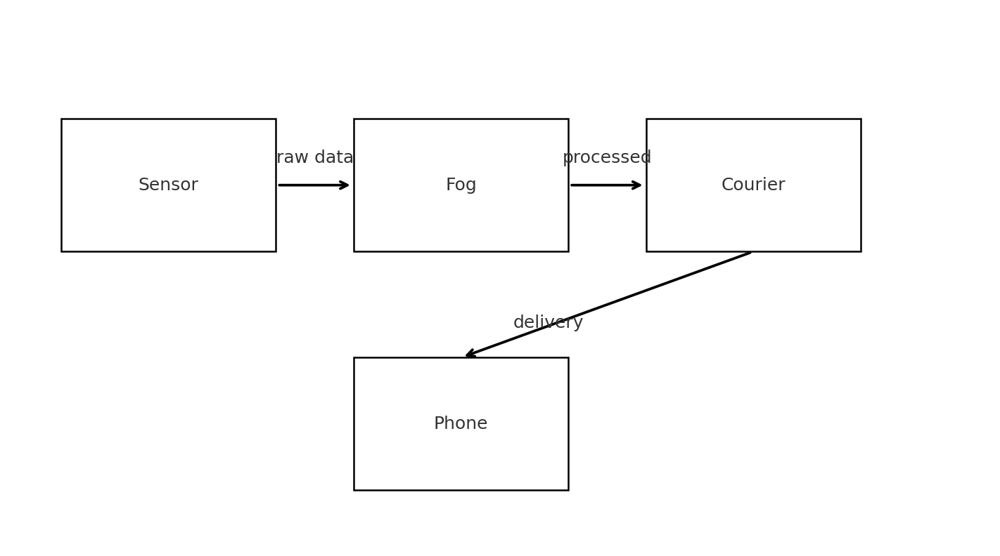
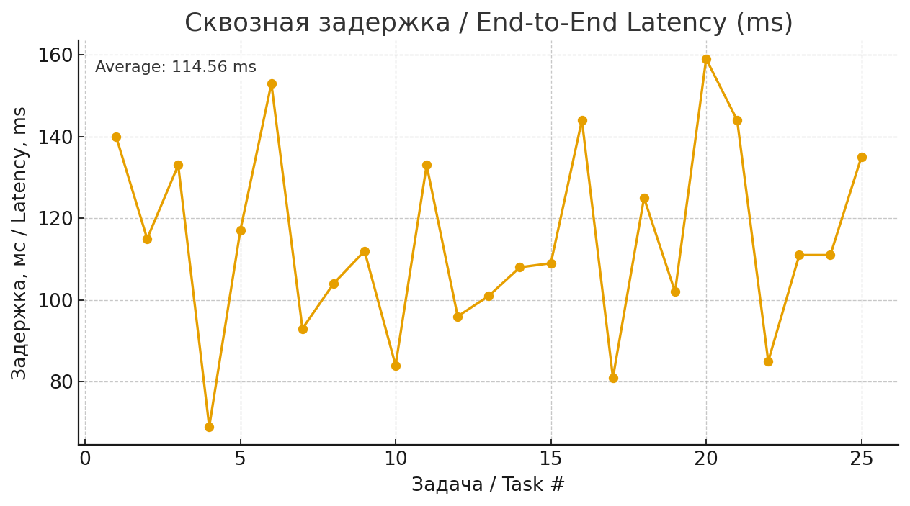
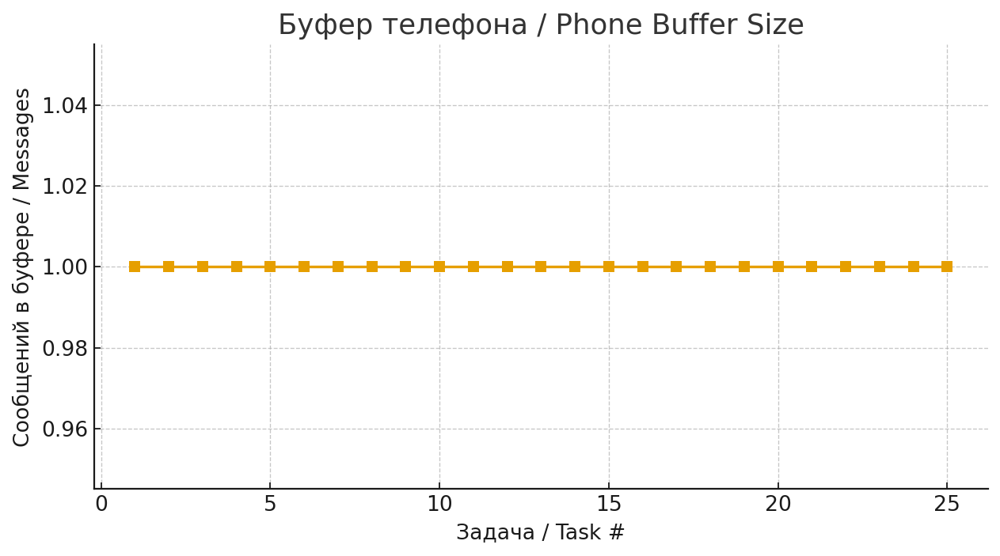

# Описание системы / System Description

## 📌 Состав системы
1. **Робот-датчик (Sensor Robot)** — собирает данные.  
2. **Fog-робот (Fog Robot)** — обрабатывает данные рядом с датчиком.  
3. **Робот-курьер (Courier Robot)** — доставляет данные дальше.  
4. **Телефон (Mobile Phone)** — принимает и складывает данные в буфер.

## 📌 Схема системы

Данные проходят путь: **датчик → fog → курьер → телефон**.

---

## 📌 Метрики
1. **Сквозная задержка / End-to-End Latency**  
   Время от датчика до телефона.  
   

2. **Буфер телефона / Phone Buffer**  
   Сколько сообщений накопилось в телефоне.  
   

---

## 📌 Назначение
Модель описывает простую IoT-систему:  
- датчик собирает данные,  
- fog-узел их обрабатывает,  
- курьер доставляет,  
- телефон принимает.  

Это помогает понять, где возникают задержки и как растёт очередь.
